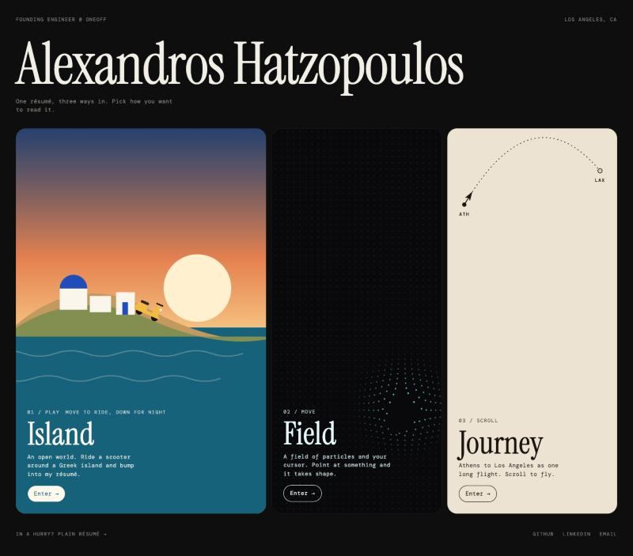
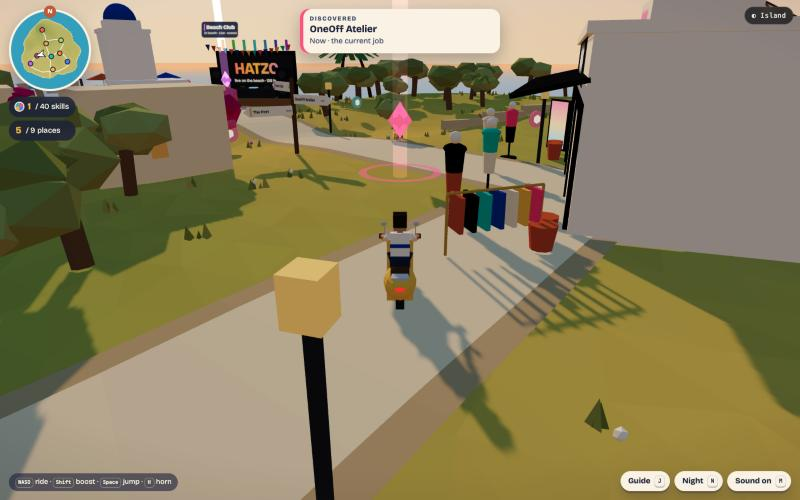
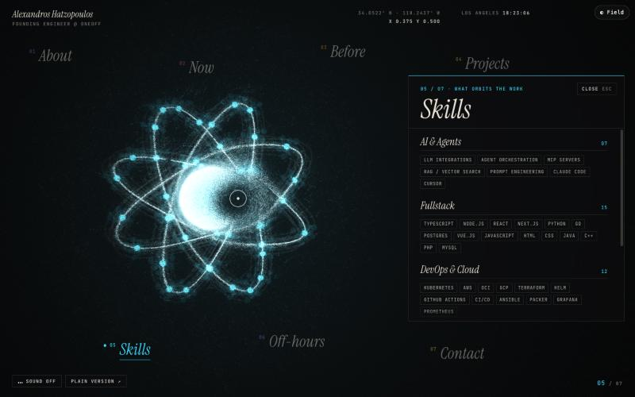
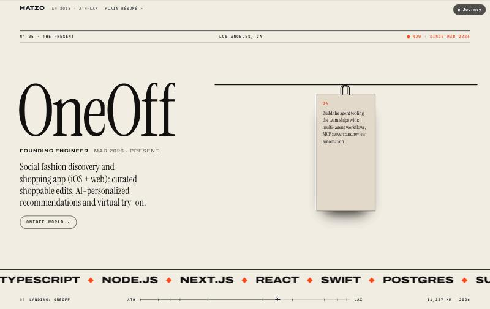

# alexhatzo/personal-website

One résumé, three interactive takes, plus a plain page.

| Route | What it is | Code |
|---|---|---|
| `/` | Hub: pick a version | `src/hub/` |
| `/game` | Island: open-world three.js island you ride around | `src/experiences/game/` |
| `/cursor` | Field: GPU particle field driven by the cursor | `src/experiences/cursor/` |
| `/scroll` | Journey: Athens to Los Angeles scroll story (GSAP + Lenis) | `src/experiences/scroll/` |
| `/plain` | Static résumé | `src/components/StaticPortfolio.tsx` |

## Editing content

Everything every version shows comes from `public/data/portfolio.json` (types in
`src/types/portfolio.ts`). Edit the JSON; all five routes update.

## Develop

```bash
npm install
npm run dev
npm run build
npm run lint
```

Vite + React 19 + TypeScript. No router library: `src/App.tsx` picks a lazy view from
`location.pathname` and `vercel.json` rewrites the routes to `index.html`.

Each experience accepts URL params that jump straight to a state (handy for screenshots
and debugging); they are listed at the top of each experience's `index.tsx`.

## Preview

| Hub | Island | Field | Journey |
|---|---|---|---|
|  |  |  |  |
